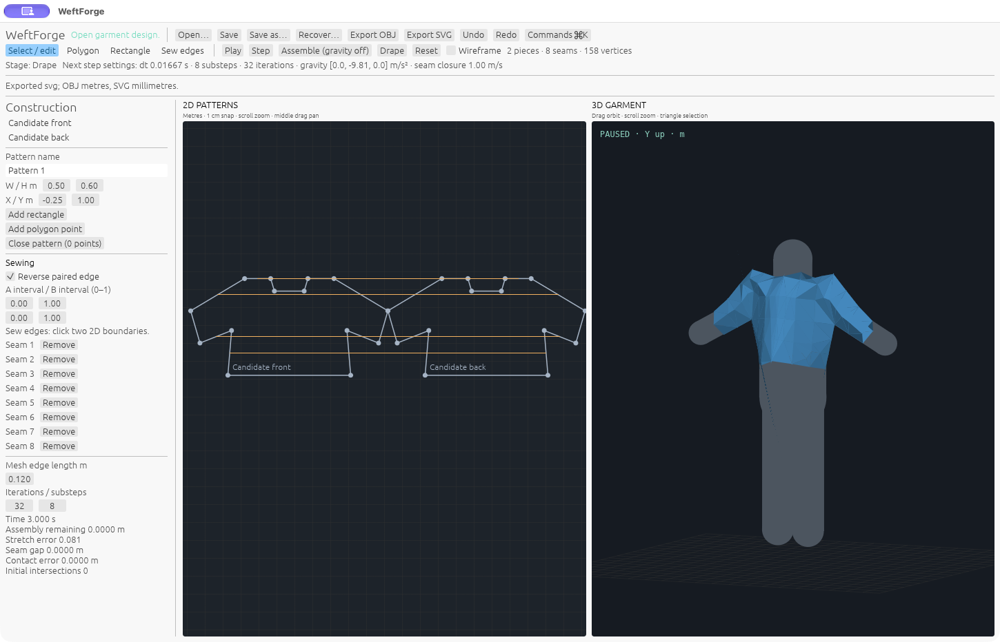

# WeftForge

**Open garment design. Patterns, fabric, and freedom.**

WeftForge is a free, open-source native Rust studio for garment design.
Create editable 2D patterns, sew and arrange pieces, explore fabric behavior,
and simulate garments in 3D. Core design, saving and export workflows run offline.

The project is in active development. See the roadmap and progress reports for
current capabilities, tested builds and remaining work.

Public repository: [thematheusmello/weftforge](https://github.com/thematheusmello/weftforge).
See [current status](STATUS.md), [generated progress](docs/progress.md), [dashboard](docs/dashboard/index.html), the
[feature registry](parity/features.yaml), and the [complete roadmap](ROADMAP.md).
Original sample projects are available in [fixtures](fixtures). See
[verification](docs/verification.md) for tested workflows and current limits.

## Current capabilities

The source implements a native eframe/wgpu workspace with a 2D pattern canvas,
basic 3D garment preview, piece selection, numeric properties, command search,
and undo/redo. Rectangle/polygon construction feeds the same Rust document engine
as the CLI. The core retains straight/cubic boundaries, oriented seam intervals,
explicit seam correspondence, authored warp direction per piece, separate warp/weft
physical stiffness, placement and derived meshes.

An f64 CPU cloth solver provides membrane/bending constraints, sewn boundaries,
gravity, ground/analytic mannequin contact, and self-contact. Simulation runs in
cancelable background batches; material values are uncalibrated approximations.
The solver is early; general garment convergence and contact robustness remain
ongoing work.

Version2 `.weftforge` JSON stores supported editable construction and reads old
version1 projects through a strict lossless migration. Older apps cannot open v2. OBJ mesh
and SVG pattern export exist; [format details and gaps](docs/file-formats.md)
explain what survives each path. Simulation frames/settings, imported avatars,
textures, animation, advanced construction and third-party project formats
remain planned. The 3D preview is basic shaded geometry;
professional rendering and GPU cloth simulation remain on the roadmap.

## Build and run

Install the Rust toolchain selected by `rust-toolchain.toml` (1.94.1). Cargo uses
pinned dependencies and the committed lockfile. The first build downloads crates;
core creation, simulation, save, and export run offline without an account or paid
service.

```bash
cargo run --release -p weftforge
cargo run --release -p weftforge-cli -- --help
```

Open a project by passing its path to the desktop binary. Start with an empty
document to exercise authoring; the CLI's `sample` command creates an original
two-panel implementation fixture and does not replace that acceptance workflow.

```bash
cargo run --release -p weftforge-cli -- new garment.weftforge
cargo run --release -p weftforge-cli -- rectangle garment.weftforge garment.weftforge Front -0.25 1.0 0.5 0.6
cargo run --release -p weftforge-cli -- inspect garment.weftforge
cargo run --release -p weftforge-cli -- export-svg garment.weftforge patterns.svg
cargo run --release -p weftforge-cli -- export-obj garment.weftforge garment.obj
```

For local stateless MCP file authoring, run `weftforge-cli mcp`. See
[automation](docs/automation.md) for supported protocols, commands and limits.
The adapter uses the same validated Rust operations; active-GUI control and MCP
simulation jobs remain open.

CLI dimensions use metres, kilograms, seconds, radians, and Y-up 3D. The desktop
currently snaps canvas gestures to 1 cm. Fine numeric editing and modifier support
remain partial.

Select a boundary in 2D or in the inspector's boundary list to edit absolute
cubic controls or make it straight. The selected edge and controls are gold;
the white marker previews the explicit split parameter. Splitting preserves
oriented sewing, including partial and gathered mappings. CLI `inspect` exposes
construction IDs, points and controls; `curve-controls INPUT OUTPUT CURVE_ID X1
Y1 X2 Y2` (or `straight`) and `split INPUT OUTPUT CURVE_ID T` use the same commands.
`T` is curve parameter, not arc length. See the
[bounded curve-editing contract](spec/features/PAT-005-sewn-curve-editing.md).

## Verify and contribute

```bash
cargo fmt --all --check
cargo test --workspace
cargo clippy --workspace --all-targets -- -D warnings
cargo xtask verify
```

Check [STATUS.md](STATUS.md) for checks actually run and platform evidence. The
target platforms are macOS (including Apple Silicon), Windows, and Linux;
source portability is not proof that every platform has been built or launched.
The CLI `benchmark PROJECT STEPS` command reports mesh sizes, CPU timing and
constraint diagnostics.

Keep core and solver code independent of the GUI, and include focused verification
with contributions. Read [AGENTS.md](AGENTS.md), [architecture](docs/architecture.md)
and [physics](docs/physics.md). Use original or appropriately licensed assets.

Original WeftForge code is licensed **MIT OR Apache-2.0**. Dependency and asset
licenses retain their own terms; see the [third-party notices](THIRD_PARTY.md).


