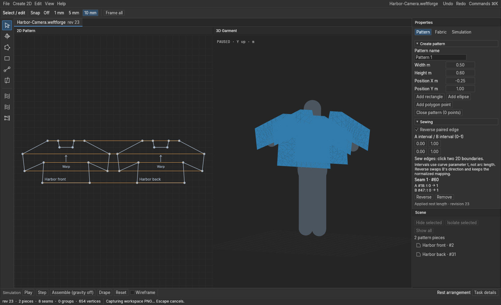

# WeftForge

**Open garment design. Patterns, fabric, and freedom.**

WeftForge is a free, open-source native Rust studio for garment design.
Create editable 2D patterns, sew and arrange pieces, explore fabric behavior,
and simulate garments in 3D. Core design, saving and export workflows run offline.

The project is in active development. See the roadmap and progress reports for
current capabilities, tested builds and remaining work.

Public repository: [thematheusmello/weftforge](https://github.com/thematheusmello/weftforge).
See [current status](STATUS.md), [generated progress](docs/progress.md), [dashboard](docs/dashboard/index.html), the
[feature registry](parity/features.yaml), and the [complete roadmap](ROADMAP.md).
Original sample projects are available in [fixtures](fixtures). See
[verification](docs/verification.md) for tested workflows and current limits.



The updated studio uses charcoal surfaces, compact menus, a left tool rail,
a document tab, paired 2D/3D canvases, Properties and Scene docks, and a slim
simulation transport. Inter and JetBrains Mono keep controls and values legible.
[PhotoCraft](https://github.com/storytold/photocraft)
informed the visual direction. See the [native preview gallery](docs/studio-preview.md)
for editable holes, Cut & Sew, reopened child editing, earlier SVG/DXF workflows, editable cubic
controls, framing, ellipses, sewing and the build's limits.

## Current capabilities

The source implements a native eframe/wgpu workspace with a 2D pattern canvas,
basic 3D garment preview, piece selection, numeric properties, command search,
and undo/redo. **Import SVG…** and **Import DXF…** add supported closed
straight/cubic pattern boundaries at physical millimetre scale, with a review
before importing. SVG requires explicit dimensions and a uniform viewBox;
DXF accepts a bounded R2000 `LINE`/clamped cubic `SPLINE` profile.
Imported boundaries remain editable. **Frame all** fits the visible outlines in
the 2D view and preserves pending numeric edits. The Scene dock can temporarily
hide or isolate patterns across both canvases. View and Command search offer
six standard 3D directions, a return to the default orbit, and **Frame garment**
for the visible 3D cloth. Rectangle,
polygon and editable four-cubic ellipse construction feed the same Rust
document engine as the CLI. The core retains straight/cubic boundaries, oriented seam intervals,
ordered M:N sewing groups, authored warp direction per piece, separate warp/weft
physical stiffness, placement and derived meshes. Groups pair cumulative authored
arc lengths across partial, reversed or disconnected spans, with editable easing
maps; legacy single seams retain their curve-parameter correspondence.

**File → Save workspace PNG…** exports the native-size 2D and 3D workspace
image. The capture above came from the reopened Harbor project on macOS.
Its saved construction stayed unchanged during export.
[Native camera and capture check](parity/reports/WF-20261119-NATIVE-STANDARD-CAMERA-VIEWS-001.json).

**Free sewing** creates partial boundary pairs from exact Start t, direction
and a Length in millimetres. Confirming A keeps a pending preview; confirming B
creates one physical-length group with one Undo step. Applied lengths and endpoint
guides show the authored pair. The bounded native check includes invalid input,
caret retention, history, saving and same-process reopen; internal sewing, full
chain workflows and garment simulation acceptance remain open.

**Internal line** adds straight annotations owned by a pattern piece, with a
two-point tool, exact endpoint editing, selection/removal and applied length
feedback. A valid endpoint edit and staged piece properties share one Undo step.
These editable annotations are stored in the strict native project format; internal shapes,
folds and internal sewing remain future work. See the
[actual native annotation gallery](docs/studio-preview.md).

**Notches** attach a physical-length I marker to an authored boundary at an
exact curve parameter. Numeric creation, editing and removal share the document
history; supported split/join edits retain the attachment. Native projects and
SVG retain markers. DXF refuses notched projects to prevent losing annotations.
The bounded native check covers creation/editing, Undo/Redo, save, fresh-process
editable reopen, SVG scale and protected DXF refusal. Other notch shapes remain
in development.

**Cut piece** divides an eligible straight pattern into two independent editable
pieces. Pick two boundaries or enter their exact curve parameters, review the
preview, then apply once. Undo/Redo and native saves retain both pieces; the
bounded restart check edits one child while preserving the other. Enable
**Sew cut edges** in review to create an oriented seam in the same operation.
The bounded Cut & Sew check covers preview/cancel, one Apply, Undo/Redo, saved
construction and a fresh-process seam removal followed by child editing.
Existing target sewing, curved contours, holes and crossing annotations refuse
the cut. General cutting and garment simulation acceptance remain open. See the
[native cut gallery](docs/studio-preview.md) and
[straight-cut contract](spec/features/PAT-006-straight-cut.md).

**Add hole…** creates one rectangular opening inside an eligible straight piece.
Its boundary points stay editable, and the hole survives native saving and
reopening. The rest mesh and OBJ export retain the opening; SVG exports a
compound outline with an even-odd fill and canvas bounds matching the pattern.
Holed projects refuse DXF export before replacing any file. Multiple or curved
holes, curved owners, hole sewing and cuts through holes remain open. See the
[hole contract](spec/features/PAT-006-straight-hole.md) and the
[native hole/export gallery](docs/studio-preview.md).

**Offset outline…** previews an Extend or Retract operation on an eligible
whole pattern. It shows before/after dimensions, authored/rest area and computed
Cloth mass. Apply produces editable straight/cubic construction and updates the
actual rest mesh and cloth in one Undo step, preserving fabric, grain and
arrangement. Target sewing, holes and internal construction refuse the operation;
uncertain geometry and exhausted budgets also refuse without changing the piece.
Persistent seam allowances and selected-edge offsets remain open. Geometry and
cloth preparation support cancellation; native responsiveness and complete
offset workflow acceptance remain pending. See
the [material-outline contract](spec/features/PAT-009-material-outline-offset.md).

**Transform pattern** translates or rotates one 2D piece, with numeric angle,
translation and pivot controls plus canvas handles. This layout operation keeps
the arranged 3D surface and world warp fixed. **New Empty**, available in File
and command search, starts a fresh editable document while protecting unsaved,
staged and unfinished work. Numeric transform/history/New/reopen have a bounded
native check; the full pointer workflow remains unverified. See the
[native gallery and limits](docs/studio-preview.md).

An f64 CPU cloth solver provides membrane/bending constraints, sewn boundaries,
gravity, ground/analytic mannequin contact, and self-contact. Simulation runs in
cancelable background batches; material values are uncalibrated approximations.
The transport's **Task details** shows the current or last background job, its
input revision, progress when available, outcome and cancellation/obsolete flags.
The inspector identifies the pattern and warp/weft direction at peak strain,
with a signed percentage for extension or compression.
The solver is early; general garment convergence and contact robustness remain
ongoing work.

Version 6 `.weftforge` JSON uses a strict schema for supported editable
construction, including ordered sewing groups and piece-owned straight internal
annotations, holes and notches. The reader supports explicit version 1–5 migrations.
Older apps cannot open v6. OBJ, GLB and embedded JSON glTF mesh export and
bounded SVG/DXF pattern import and export are available. The
[format details](docs/file-formats.md) explain what survives each path.
Simulation frames/settings, imported avatars,
textures, animation, advanced construction and third-party project formats
remain planned. The 3D preview is basic shaded geometry;
professional rendering and GPU cloth simulation remain on the roadmap.

## Build and run

Install the Rust toolchain selected by `rust-toolchain.toml` (1.94.1). Cargo uses
pinned dependencies and the committed lockfile. The first build downloads crates;
core creation, simulation, save, and export run offline without an account or paid
service.

```bash
cargo run --release -p weftforge
cargo run --release -p weftforge-cli -- --help
```

Open a project by passing its path to the desktop binary. Start with an empty
document to exercise authoring; the CLI's `sample` command creates an original
two-panel implementation fixture and does not replace that acceptance workflow.

```bash
cargo run --release -p weftforge-cli -- new garment.weftforge
cargo run --release -p weftforge-cli -- rectangle garment.weftforge garment.weftforge Front -0.25 1.0 0.5 0.6
cargo run --release -p weftforge-cli -- inspect garment.weftforge
cargo run --release -p weftforge-cli -- export-svg garment.weftforge patterns.svg
cargo run --release -p weftforge-cli -- export-dxf garment.weftforge patterns.dxf
cargo run --release -p weftforge-cli -- export-obj garment.weftforge garment.obj
cargo run --release -p weftforge-cli -- export-glb garment.weftforge garment.glb
cargo run --release -p weftforge-cli -- export-gltf garment.weftforge garment.gltf
```

For local stateless MCP file authoring, run `weftforge-cli mcp`. See
[automation](docs/automation.md) for supported protocols, commands and limits.
The adapter uses the same validated Rust operations; active-GUI control and MCP
simulation jobs remain open.

Use **M:N sewing** to collect side A spans in order, confirm A, then collect and
confirm B. The inspector supports precise span endpoints, directions, ordering
and easing-map edits. `weftforge-cli inspect-sewing PROJECT` exposes the authored
groups, derived portions and weighted rest-mesh stitches for headless inspection.

CLI dimensions use metres, kilograms, seconds, radians, and Y-up 3D. The desktop
inline **Snap** selector offers Off, 1 mm, 5 mm, or 10 mm (default) for existing pointer
positions. Hold Alt / Option when starting a drag or clicking to bypass. This
session preference survives opening projects; numeric edits stay exact.

Select a boundary in 2D or in the inspector's boundary list to edit absolute
cubic controls or make it straight. The selected edge and controls are gold;
the white marker previews the explicit split parameter. Splitting preserves
oriented sewing, including partial and gathered mappings. CLI `inspect` exposes
construction IDs, points and controls; `curve-controls INPUT OUTPUT CURVE_ID X1
Y1 X2 Y2` (or `straight`) and `split INPUT OUTPUT CURVE_ID T` use the same commands.
`T` is curve parameter, not arc length. `join INPUT OUTPUT CURVE_ID` and the
inspector’s **Join with next boundary** restore compatible neighboring segments
while preserving sewing. Unsupported corners or exhausted precision budgets
produce a validation error. See the
[bounded curve-editing contract](spec/features/PAT-005-sewn-curve-editing.md).

Selected boundaries show their **applied rest length** in Properties, in
millimetres with the source revision. Legacy seams and M:N groups show A/B side
lengths and signed **B − A**. Unapplied numeric drafts and point previews are
excluded. These measure authored construction independently of cloth positions.
`weftforge-cli lengths PROJECT interval CURVE_ID T0 T1` (or `seam ID` /
`sewing-group ID`) and MCP `project_lengths` return unrounded SI values without
writing files. See [automation](docs/automation.md) and the
[native readouts](docs/studio-preview.md).

## Verify and contribute

```bash
cargo fmt --all --check
cargo test --workspace
cargo clippy --workspace --all-targets -- -D warnings
cargo xtask verify
```

Check [STATUS.md](STATUS.md) for checks actually run and platform evidence. The
target platforms are macOS (including Apple Silicon), Windows, and Linux;
source portability is not proof that every platform has been built or launched.
The CLI `benchmark PROJECT STEPS` command reports mesh sizes, CPU timing and
constraint diagnostics.

Keep core and solver code independent of the GUI, and include focused verification
with contributions. Read [AGENTS.md](AGENTS.md), [architecture](docs/architecture.md)
and [physics](docs/physics.md). Use original or appropriately licensed assets.

Original WeftForge code is licensed **MIT OR Apache-2.0**. Dependency and asset
licenses retain their own terms; see the [third-party notices](THIRD_PARTY.md).
