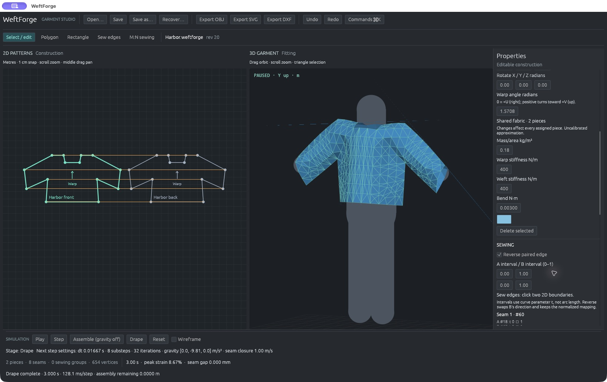
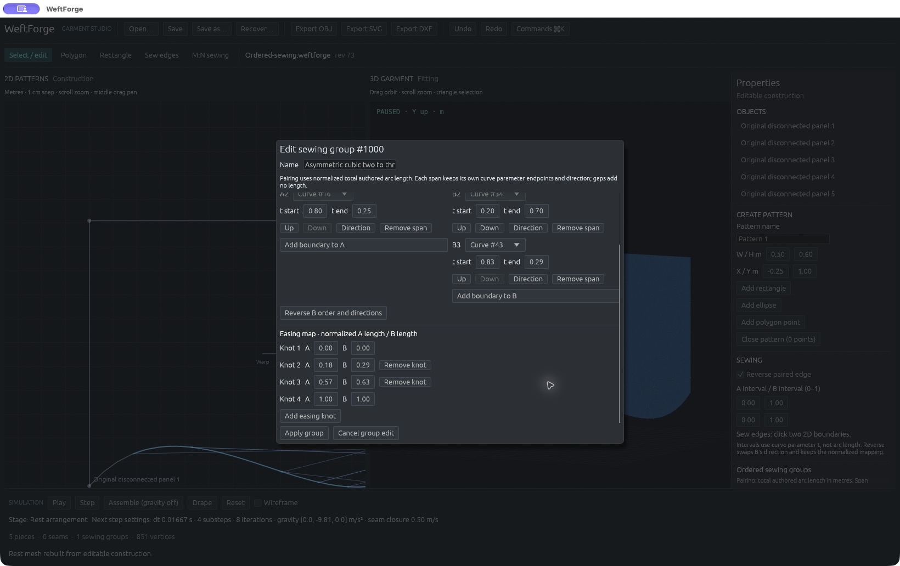

# Native studio preview

These are unedited captures of the running Rust desktop application on macOS
at 1640 × 1032 pixels. The current build is
`32f9b3481c46e28a3b3acc49e6cf3908c7001b28`. PhotoCraft informed the charcoal
workspace and teal accents; the application, documents and graphics are original
WeftForge work.

## Current garment workspace

The current toolbar includes **Import SVG…** and **Frame all**, alongside file,
history and construction tools. The shirt view shows rest arrangement with two
editable panels and eight seams. Properties and simulation transport remain
available beside and below the paired viewports.

## SVG scale review and editable imported curves

Import reviews the piece count, physical scale, retained origin and omitted
properties before adding anything. The bounded profile accepts closed absolute
straight/cubic paths with explicit millimetres and uniform viewBox scale. It
imports exterior boundaries and names; the [format profile](file-formats.md)
describes the supported subset.

The selected imported cubic exposes its original control points. This actual
native edit moves its first control X from 0.08 to 0.09 m. **Frame all** keeps the
separated patterns visible using their authored curve bounds.

The current workflow exercises cancellation with a pending numeric edit, atomic
import, one-step Undo/Redo, control editing, invalid-input retention, SVG export
and an actual quit/relaunch/reopen/resave. Independent checks verify geometry,
physical scale, stable IDs and native persistence. The retained earlier v1/v2
strict failures remain separate from the prospectively declared v3 verification;
see the [evidence packet](../parity/reports/artifacts/native-svg-20261115/README.md)
and [current status](../STATUS.md).

## Earlier workspace capture (b760)

The following four captures retain their original tested source
`b760b990b142bb46b2481434fead9e7e0178ae0f` and evidence limitations.

The document bar provides open, save, recovery, exports, history and command
search. Pattern tools sit above the two viewports. The inspector exposes
placement, grain, fabric and sewing properties; the transport and diagnostics
stay below the viewports. The pictured Harbor fixture has two editable pieces,
eight seams and 654 simulation vertices after assembly and draping.

## Editable ellipses and cubic controls

Numeric ellipse creation uses four editable cubic Bézier boundaries. Selected
curves expose their controls and split parameter. The same validated operation
is available through command search, the CLI and the local MCP adapter. This is
a cubic approximation, with no persistent exact-conic constraint after editing.
See the [ellipse contract](../spec/features/PAT-003-original-ellipse-20261114.md).

## Ordered sewing and easing

Ordered M:N groups pair authored boundary spans by cumulative arc length.
The inspector supports partial and reversed spans, ordering and explicit
correspondence instead of pairing mesh vertex indices.

Easing-map knots control correspondence along the two sides. This capture shows
the actual editor dialog on an original five-piece sample, then cancelled
without changing the saved construction.

## What this preview establishes

The earlier gallery establishes the observed b760 layout and displayed authoring
tools at that source. The [retained preview receipt](../parity/reports/artifacts/studio-preview-20261114/PREVIEW-RECEIPT.json)
binds the images to the observed executable and records earlier failed layout
attempts and an undeclared play event. The saved examples are available in the
[document directory](../parity/reports/artifacts/studio-preview-20261114/documents).

The preview loaded existing sample documents. The separate empty-project garment
acceptance remains a different workflow. A zero displayed contact value does
not establish surface clearance: independent checks found triangle/capsule
penetration in the Harbor results. Cloth convergence, full contact coverage,
calibrated fabrics, production rendering, avatar import, animation, advanced
construction and cross-platform launch remain incomplete. See the
[complete roadmap](../ROADMAP.md) and [current status](../STATUS.md).

The original preview checks used shared compiled-cache links. Their raw results
are retained with that qualification. Fresh isolated formatting, workspace tests,
strict Clippy, xtask verification and packaging all passed, reproducing the
observed native executable byte-for-byte. The
[build qualification](../parity/reports/artifacts/studio-preview-20261114/BUILD-ISOLATION-QUALIFICATION.json)
records the finding and correction. GitHub Actions and Pages remain disabled
during development.
