# Native studio preview

## Harbor patterns and seam layout

The native studio saved this view after reopening the two Harbor pieces and
checking their eight seams. The front height edit, Undo and Redo kept the
seam relationships. The 3D viewport shows the rest arrangement.
[Native workflow and exports](../parity/reports/WF-20261118-HARBOR-NATIVE-AUTHORING-REOPEN-001.json).

## Workspace PNG saved by WeftForge

File → **Save workspace PNG…** saved this 1640 × 1000 image from the native
renderer on Apple Silicon. An independent check decoded the original PNG and
confirmed its dimensions and standard sRGB metadata. The Harbor sample stayed
at revision 20 in its rest arrangement, with identical project bytes before
and after capture. [Native run](../parity/reports/WF-20261118-NATIVE-WORKSPACE-PNG-P003.json).

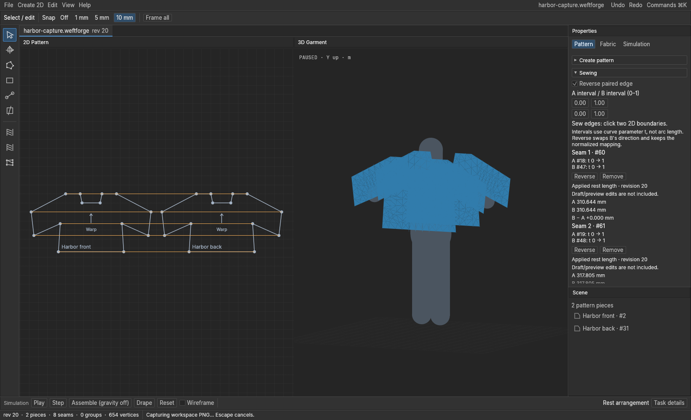

## Rectangle creation and reopened corner edit (7d19 / ae8)

These are actual native captures from tested source
`7d19f86a006601133d457aee42cca3b115b994aa`, whose 88 source inputs match current
`ae8dd6ebe6da760501f507248a11b069a02cb453`. One Rectangle drag creates an
editable **400 × 600 mm** piece. One Undo returns to empty; Redo restores the
same construction. Native saves and an explicit fresh-process restart reopen
that saved piece, followed by one **10 mm** corner edit and another save.

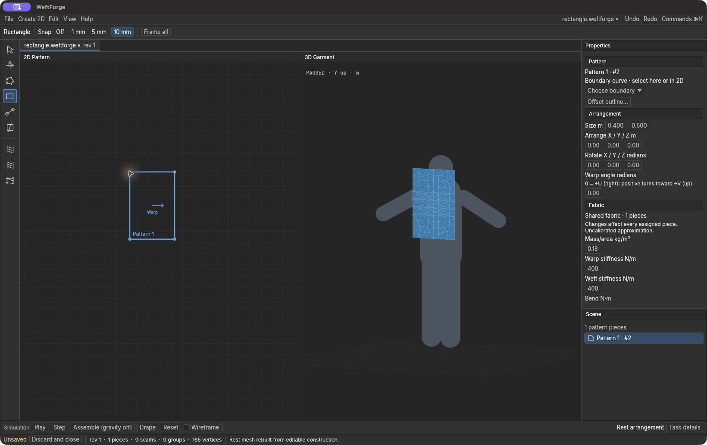

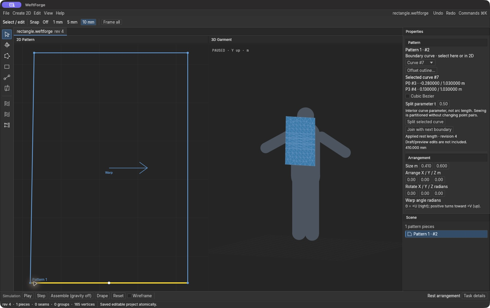

The separate, independently frozen saved-file check passed once. The original
native case missed its **900 s whole-case finalization cap**, closing at
1008.46 s, and remains failed. These observations and the file-only pass do not
establish whole-native-workflow, garment, physics, full-feature or reference
acceptance. See the [native report](../parity/reports/WF-20261116-RECTANGLE-NATIVE-001.json)
and [separate file supplement](../parity/reports/WF-20261116-RECTANGLE-FILE-SUPPLEMENT-001.json).

Public copies zero only eight ICC display identifier bytes per image. Encoded
scans, color-characterization tags and all other bytes remain exact; no raster
editing or re-encoding occurred. The [metadata journal](../parity/reports/artifacts/rectangle-gesture-20261116/JPEG-METADATA-REDACTION.json)
and [current publication index](../parity/reports/artifacts/rectangle-gesture-20261116/PUBLICATION-CURRENT.json)
distinguish them from the unchanged private originals and historical selection.

## Cut & Sew and reopened seam removal (5898)

These are actual native UI captures from source
`5898f1a1274f8632d96b5fd0898f8253dee2f4db` and executable
`7809e41948e19d0055da45e10a3b55225173df48e43465fab1b48effd7efa1c8`.
The bounded S1/S2 cases passed separate saved-file and UI reviews. Their results
remain attributed to that build; they are stale on the changed SVG-export source.
Public JPEG copies remove eight device-identifier bytes per image from the color
profile. Encoded pixels and the remaining bytes match the private originals; the
[publication index](../parity/reports/artifacts/cut-and-sew-20261116/PUBLICATION-CURRENT.json)
records image, path and tool-history derivatives and whole-file omissions.

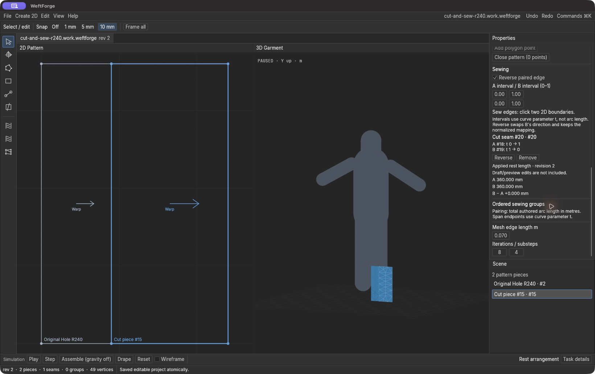

The review's **Sew cut edges** option adds a seam in the same operation as
the straight cut. Each side measures 360.000 mm, with opposite authored
directions. Invalid unfinished input and Cancel retain the original piece;
one Undo/Redo restores the same construction IDs and seam.

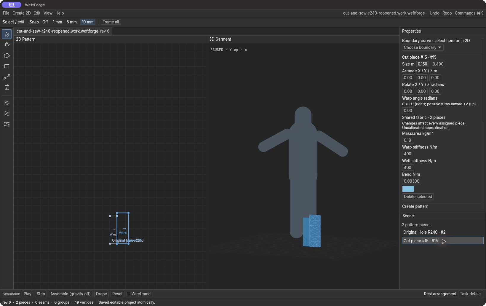

A fresh process opens the actual Redo save. Removing the seam preserves both
pieces; changing child #15 to 0.400 m height leaves the other child's saved
anchors unchanged. These are authoring/history/persistence checks. Native cloth
mass, drape, contact, broader cutting and full sewing acceptance remain open.
See the [bounded report](../parity/reports/WF-20261116-CUT-AND-SEW-001.json).

## Editable holes and physical-scale export (a021 / 947)

The original H1 creation/edit/history/save case belongs to source
`a021a2581c8e1dd000e535a417dcd964c3835884` and executable
`4b5623d59fe897bfe507eed93c9d6982492fdcc18c9d6414a80e98f057ff869c`.
Its accepted save is the explicit historical input to fresh export case H3,
source `947bfbe4dcb74fb253d584709376ace5a08db838`, executable
`f74350126898e07729f898cb641442baecacc29404f5620b1cfabb03926e282a`.
The [H1 report](../parity/reports/WF-20261116-STRAIGHT-HOLE-001.json) is stale;
H3 does not establish current-build hole creation acceptance.

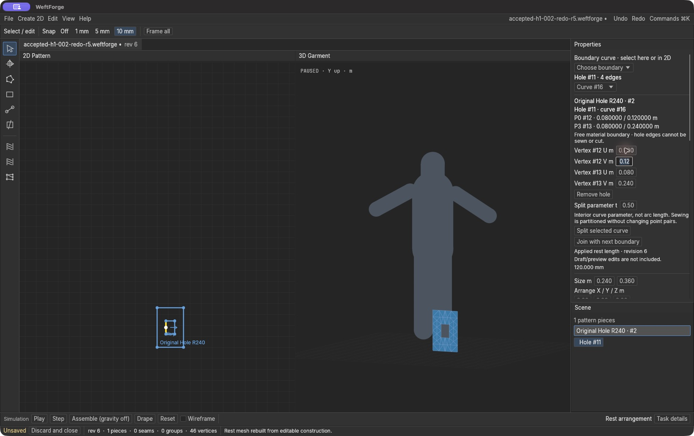

H3 moves point #12 to U=0.080 m, saves native v5, exports an annular OBJ and
exports a compound even-odd SVG with a 240 × 360 mm canvas. DXF refuses the
unsupported holed project while preserving both existing output and recovery
files. An independent saved-file assessment and separate UI review passed.
The original postflight guard still records a failed string-versus-integer
permission comparison; a separate direct byte/permission audit supplies the
qualification. The earlier H2 SVG-padding failure remains failed. See the
[qualified H3 report](../parity/reports/WF-20261116-HOLE-EXPORT-001.json) and
[publication index](../parity/reports/artifacts/straight-hole-20261116/PUBLICATION-CURRENT-003.json)
for original/derivative hashes, omissions and historical scope.

All three finished test processes exited. These cases supply bounded
implementation evidence, with no reference-parity or cloth-physics acceptance.

## Straight cuts and reopened child editing (19b1)

These native frames come from runtime
`19b1e88245dc627cfec8164f4924b335fe44853d` and executable
`117981304290aca8ea5f2d63bb77d81641791667bdc8ee89e5cb2b92de3c8d3e`.
The two bounded cases start with actual empty UI authoring, then reopen the
actual accepted Redo save in a fresh process. Saved-file assessment and raw-UI
review are separate; both passed their original criteria.
Public copies remove device identifiers from color-profile metadata; their
encoded pixels and color data are unchanged. The
[metadata record](../parity/reports/artifacts/straight-cut-20261116/JPEG-METADATA-REDACTION.json)
distinguishes these copies from the untouched private originals.

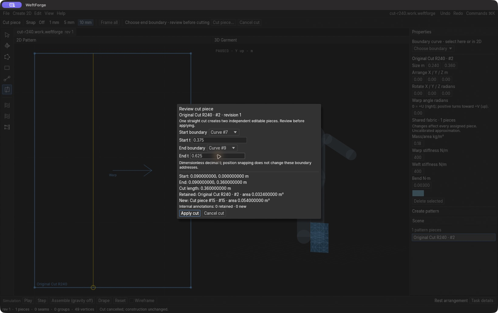

The original rectangle is 0.24 × 0.36 m. Curve #7 at t=0.375 and curve #9 at
t=0.625 define a vertical cut at U=0.09 m. The review shows the proposed
0.0324 / 0.054 m² pieces before accepting anything. Unfinished `1e-` is refused;
the [no-refocus caret witness](../parity/reports/artifacts/straight-cut-20261116/native/R003/captures/invalid-start-caret-witness-one-e-zero-minus-0.jpg)
retains `1e0-`. Explicit Cancel and a later backdrop click leave R1 unchanged.
Two pointer picks open review without applying a cut.

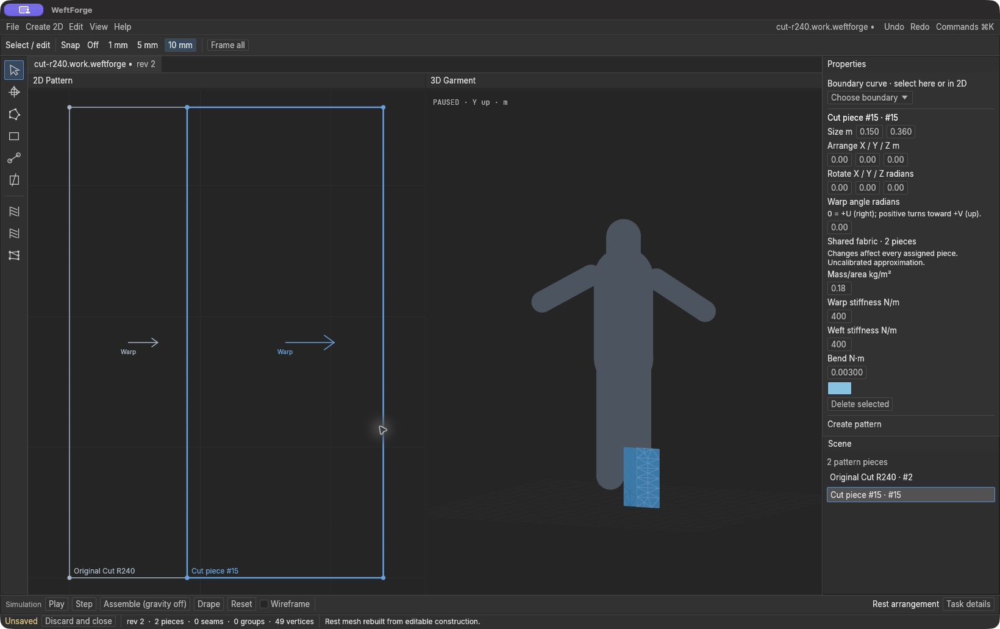

One Apply creates R2 and selects child #15. Its size is 0.15 × 0.36 m; retained
piece #2 is 0.09 × 0.36 m. Undo restores the single rectangle at R3; Redo restores
the same two independent pieces at R4. Four clean native saves retain the declared
IDs, boundary walks, allocator high-water, materials, placement and grain.

A fresh process loads the exact R4 snapshot. Editing child #15's height to
0.40 m and pressing Tab once commits R5. The
[retained piece inspection](../parity/reports/artifacts/straight-cut-20261116/native/CUT-R2/R2-001/captures/reopen-retained-piece-two-inspected-r5-0.jpg)
still shows 0.09 × 0.36 m. Independent saved-state checks verify the retained
anchors and IDs; the child's intentional area increase is separate from the
pre-edit cut conservation check. Both owned test processes quit and their exits
were verified separately.

This is a straight, unsewn rectangle workflow. Native concave/failed-I/O cases,
general cutting, holes, Cut & Sew and reference parity remain open. R2's
contradictory draft-only metadata flag is preserved with its clarification and
qualified acceptance; actual required dependency files/hashes were present.
Earlier setup/focus failures and the focus diagnostic's timing uncertainty remain
in the [bounded report](../parity/reports/WF-20261116-STRAIGHT-CUT-001.json) and
[evidence collection](../parity/reports/artifacts/straight-cut-20261116/README.md).
The shaded 3D rest preview is not a drape or contact-quality acceptance.

## Historical straight internal annotations (ad7, native A only)

These are untouched product-UI images from runtime
ad7cc8bbbfc7a1ae735a400c21dcc7a37c80a5c5 and native debug executable
a733c9952ff060a3ec96417467be50011a16039dbb0868fd8ac9890a2b5897c4.
Root accepted bounded A003 after a separate review of all 60 original images and
142 returned pairs; root directly reviewed fourteen keyframes. The saved grader
ran once and passed six native v4 states. B–E remain required and are outside this
packet’s coverage. Full annotation, accessibility, reference and garment acceptance remain open.
Its evidence is stale on the changed cut runtime; the original result is preserved.

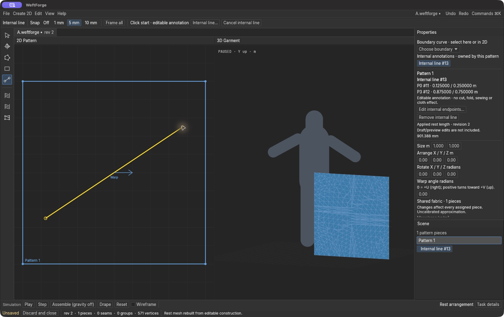

Two clicks create internal curve #13 at R2, owned by Pattern 1. Its endpoints are
[0.125, 0.25] and [0.875, 0.75] metres; applied length reads 901.388 mm.
The first click stayed transient at R1. Its separate capture is retained, with the
qualification that the cursor partly obscures the anchor marker. The line is an
editable annotation; the 3D rest preview does not establish a cloth constraint,
cut, fold or sewing effect.

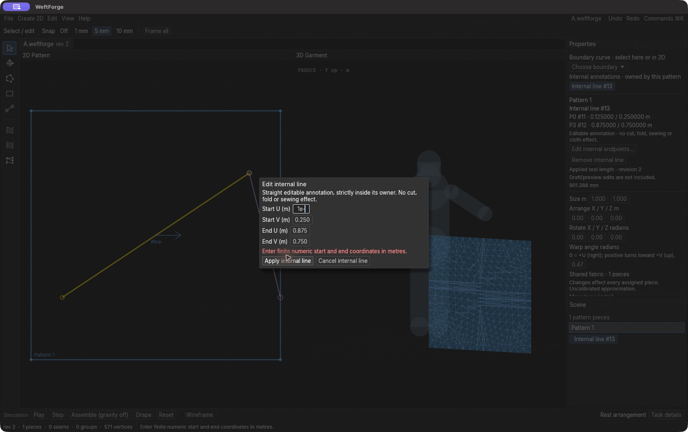

Start U `1e-` remains visible after refusal at R2. The case separately observes
modal Save blocking, backdrop cancellation and explicit cancellation. Its
[grain caret witness](../parity/reports/artifacts/internal-annotations-20261115/native/A003/captures/grain-caret-witness-0.jpg)
retains `0.470e0` without an accepted revision change. These observations do not
establish full modal AX accessibility, held input or strict same-frame delivery.

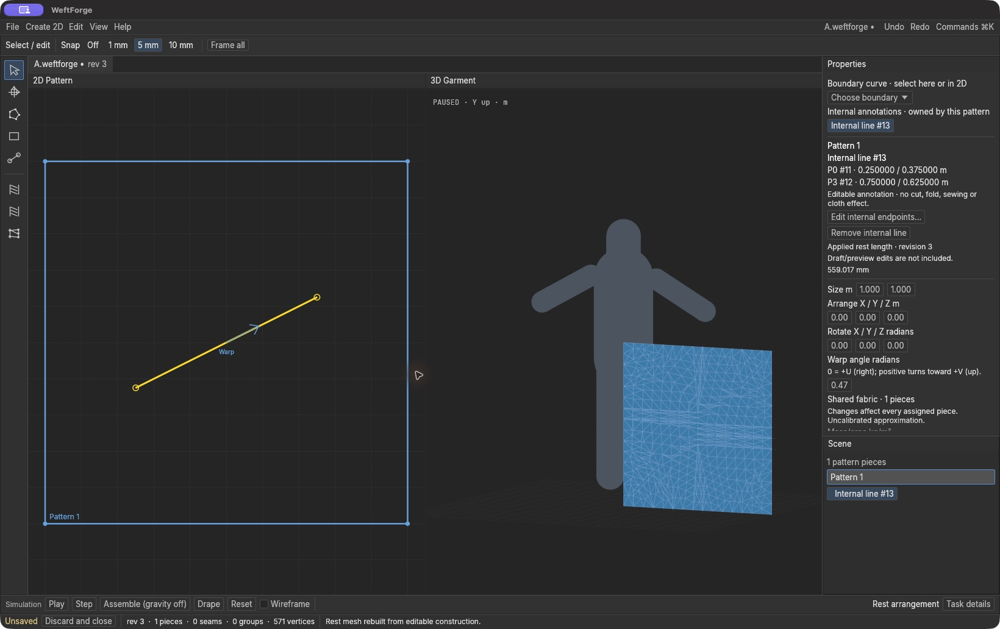

One Apply changes endpoints to [0.25, 0.375] / [0.75, 0.625] metres and grain to
0.47 radians at R3. Applied length reads 559.017 mm. One
[Undo at R4](../parity/reports/artifacts/internal-annotations-20261115/native/A003/captures/compound-edit-undone-0.jpg)
and [Redo at R5](../parity/reports/artifacts/internal-annotations-20261115/native/A003/captures/compound-edit-redone-0.jpg)
retain the declared state/history checks. Six exact native saves and previous
primary/recovery bytes are retained separately; this is no native Recover, New,
process-restart or full automation acceptance.

A003 used 142 operations plus one summary, with a conservative elapsed upper bound
641.657843875 s within 175+1 / 1200 caps, and quit its owned process. The initial
full getApp AX is missing; the first complete raw initial-state capture precedes
authoring. Immediate/exactly-once completion relies on tool history and stored
bounds. A001's zero-execution setup error and A002's stopped/unaccepted procedure
and single failed saved grade remain unchanged, with later cleanup recorded
separately. See the [scoped report](../parity/reports/WF-20261115-INTERNAL-ANNOTATIONS-001.json)
and [tracked packet](../parity/reports/artifacts/internal-annotations-20261115/README.md).

The separate [half-step physics diagnostic](../parity/reports/WF-20261115-HARBOR-HALF-STEP-001.json)
remains failed: 16.5470055% peak strain at frame 29, despite completing all 181 saved
states. It supplies no physics, convergence or native credit to these annotations.

## Historical physical-length Free sewing (B657)

These historical native002 images retain their original bounded acceptance;
the B657 report is stale on changed ad7 source. They are actual unedited images from source
b657e6bf52aca6c0c76c5c51aaf76b4e812150f7 and executable
69af2254e9f1346dbd9abf018d66ff731eea4660b2efd71df195916c8b195cd0.
Root accepted this bounded engineering workflow after reviewing twelve images,
all 161 returned action pairs, source/freeze pins and the four saved primaries.
This is partial Free sewing, not a complete sewing/New/garment/reference pass.

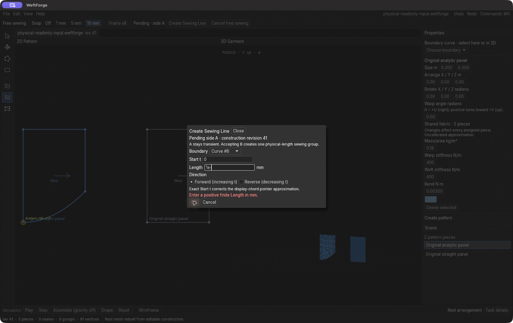

Length 1e- is rejected at R41. Cancel restores unrelated width/caret; the retained
[0.20e0 witness](../parity/reports/artifacts/physical-length-sewing-20261115/native/002/captures/width-caret-witness-0.jpg)
shows the insertion without a revision change. Full native AX/accessibility remains
unqualified; modal field evidence here is in the raw images.

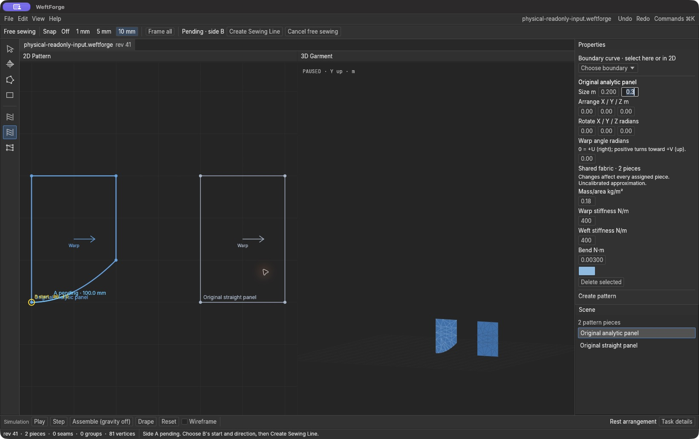

Side A uses curve #6, Forward, 100 mm. It remains pending at R41 with zero groups.

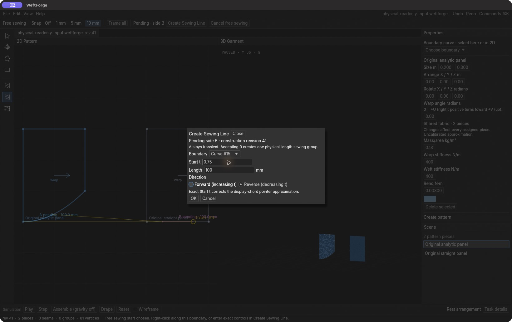

Side B uses curve #15, exact Start t 0.75, Reverse and 100 mm. Boundary, exact t and
direction controls complement pointer picking. Entered physical lengths choose
creation endpoints; they are not persistent dimension locks. Reference picking,
rounding, cancellation and unequal-length easing semantics remain unqualified.

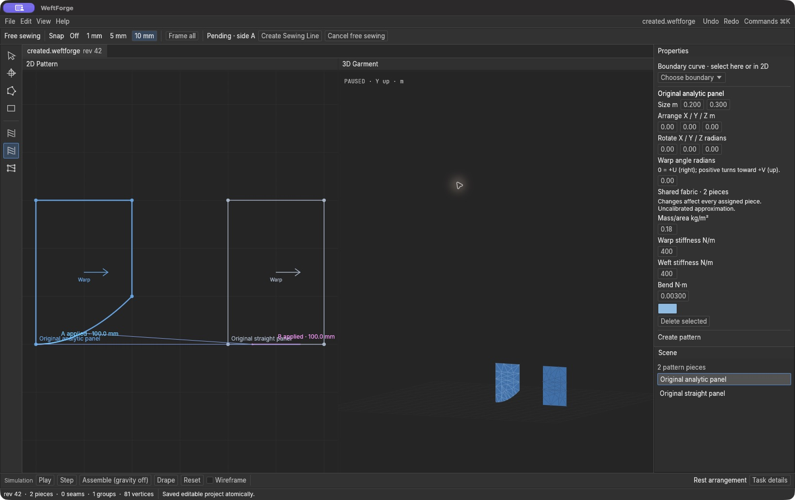

Accepting B creates one group 20 at R42 with two 100.0 mm labels and endpoint guides.
One [Undo R43](../parity/reports/artifacts/physical-length-sewing-20261115/native/002/captures/undo-saved-r43-0.jpg)
removes the pair; one [Redo R44](../parity/reports/artifacts/physical-length-sewing-20261115/native/002/captures/redo-saved-r44-0.jpg)
restores it. All four required native primaries retain their first saved hashes.

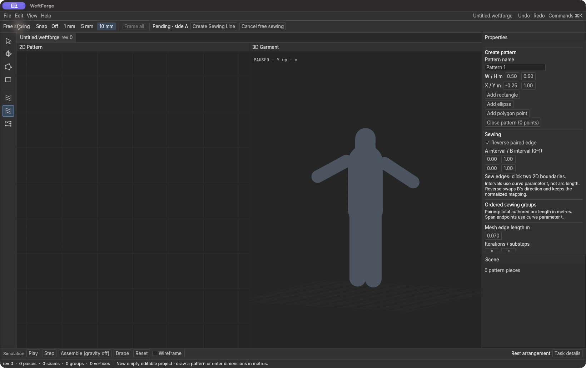

File New Empty creates R0 with the default analytic mannequin; Undo and Redo each
remain no-op R0. This one clean reset is not full New/recovery acceptance.

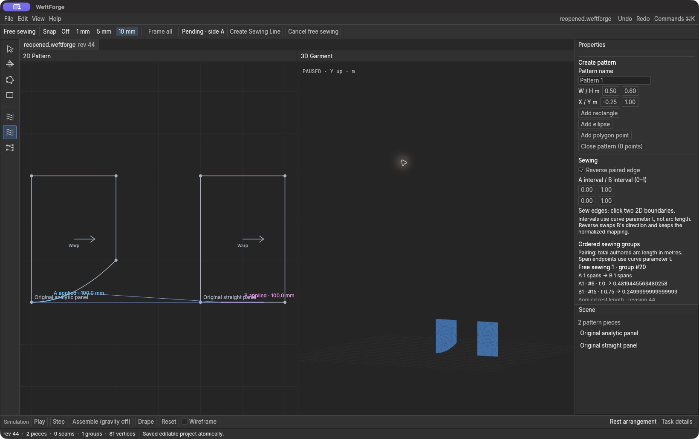

The frozen saved-output grader ran once and passed parsed-field/metric checks
at 1e-8 m. Redo/reopened bytes are identical. Root separately reviewed the native
trace/images; a saved file alone does not prove caret, live history or New behavior.
The case used 162 calls including summary / 748.816649 seconds within 220 / 1200
caps and quit its own process. Same-process reopen is not a process restart.

Failed001 remains stopped before Save at the wrong filename; its autosave is no
replacement for four missing primaries. The intervening calibration observes
filename entry/Cancel only. A later user-requested cleanup closed old unused GUI
windows separately from every case clock and outcome. See the
[scoped report](../parity/reports/WF-20261115-PHYSICAL-LENGTH-SEWING-001.json) and
[retained packet](../parity/reports/artifacts/physical-length-sewing-20261115/README.md).

The original B657 source gates retain 254 Rust/54 Python passes and six zero
command exits; their predicted Rust total 255 / match=false bookkeeping remains
visible. No source/native/headless acceptance was rerun for publication. The DD
Transform images below retain their original A4 pass/B failure, now stale on changed
B657 runtime. No native Transform B or unexecuted B2 success is inferred.

## Historical one-piece transform and New Empty (DD)

These are actual unedited A4 captures from source dd5a16826dafe0d4f32c251f7c351197ad0936af,
using the separately bound native debug executable 216aa9e0b8968a1fe9033f32c89c9b4b93cdca15fac927c0538a5a091c848dd4.
Root accepted this bounded numeric/history/New/same-process reopen case after
reviewing twelve product-UI images and the paired records. The overall frozen
A/B native plan remains failed/unverified because pointer case B did not reach
its required first translation revision. The PhotoCraft reference below is visual
inspiration, not behavior or parity evidence.

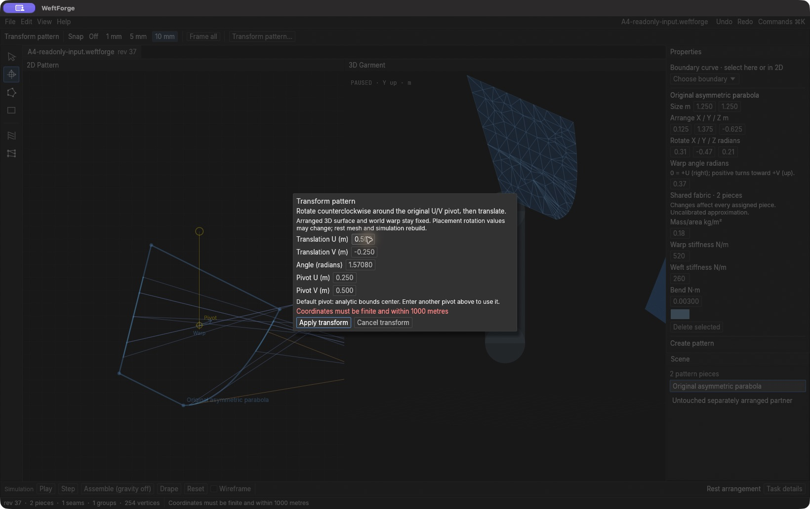

The original asymmetric piece uses translation 0.5 / -0.25 m, a quarter-turn
angle and pivot 0.25 / 0.5 m. This image is a pending dialog, not applied construction.
The separate exact-angle capture is retained in the packet. Modal numeric values
were reviewed in images; full modal AX accessibility is still unqualified.

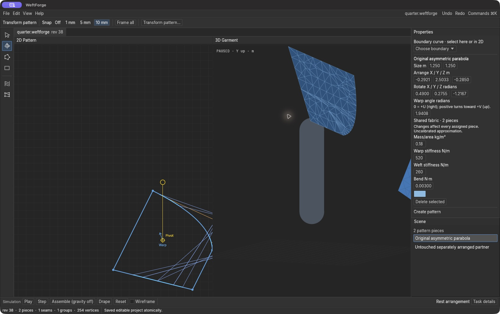

The saved grader passed the frozen coordinate/curve, arranged-world, grain and
history checks. One Undo and Redo were saved separately. The layout transform
keeps arranged 3D geometry/world warp fixed under the declared engineering policy;
reference semantics remain unknown.

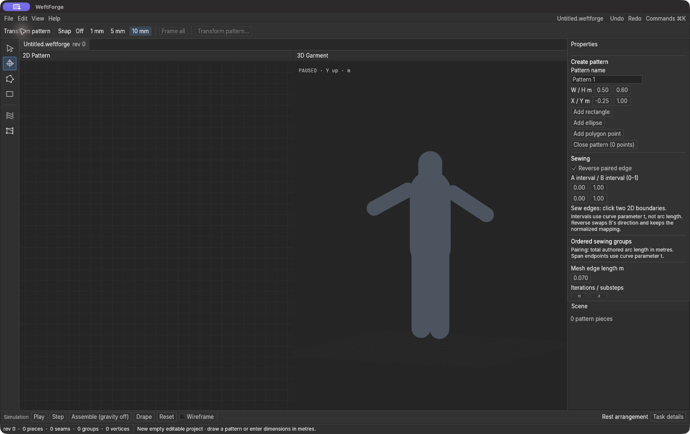

New Empty creates a fresh editable document. Source checks also cover refusal
when accepted changes, staged/invalid properties or unfinished construction need
attention, and prevent old worker results from entering the new document.

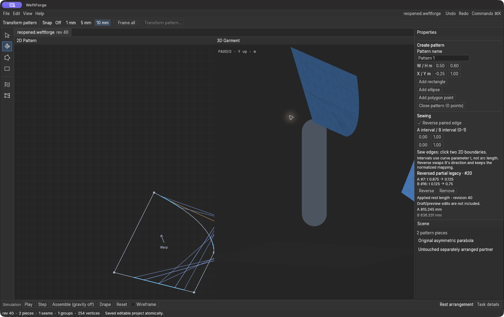

A4 completed 121 pairs in 542.54376275 seconds within its unchanged 130 / 900 caps;
its grader ran once. Redo and reopened saved bytes are identical. This is a
same-process reopen, not a process restart, physics, export or full-feature pass.

B is retained separately: after a pre-authoring root hold, one documented drag
returned but both reviewed checkpoints still showed R40, not required R41.
Its filename ending R41 describes intent. The case stopped with 11 pairs in
204.564500916 seconds, without a corrective drag, rotation or Save; grading failed
on missing translated/rotated outputs. No mid-drag/OS-button witness establishes
the cause. Source tests or ideal content-space input cannot prove actual OS delivery
or a product defect. See the [failed overall scoped report](../parity/reports/WF-20261115-PATTERN-TRANSFORM-001.json)
and [retained packet](../parity/reports/artifacts/pattern-transform-20261115/README.md).

Fresh source gates pass 235 Rust and 54 Python tests plus formatting, strict
Clippy, registry/map checks and unsigned packaging. They do not complete the
native A/B plan or any reference/garment/roadmap gate. Earlier A/A2/A3 failures,
source-review REDs and historical images below keep their original outcomes.

## Historical authored-length readouts (be8)

Actual unedited 1640 × 1032 captures from source `be8a031b5f8342d0857f3bed34f52dd165fa86da`
show the new measurement subset on an original analytic fixture. Its deliberate
3D placements are outside the default camera; these are readout checks, not a
3D garment/rendering acceptance. The PhotoCraft-inspired shell remains below.

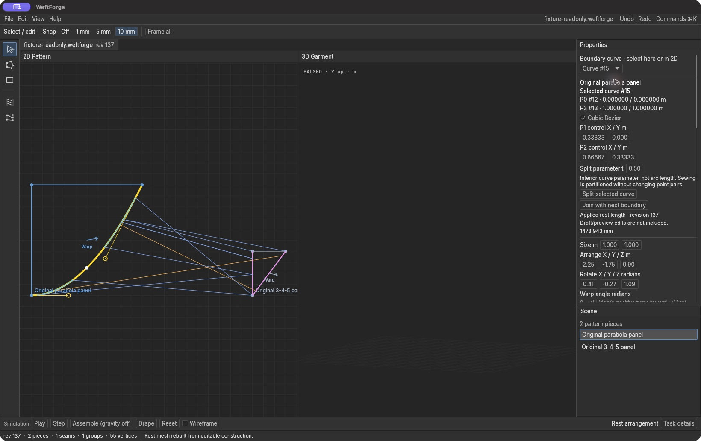

The independent parabola gives 1478.943 mm. The label identifies applied revision 137
and explicitly excludes drafts/previews.

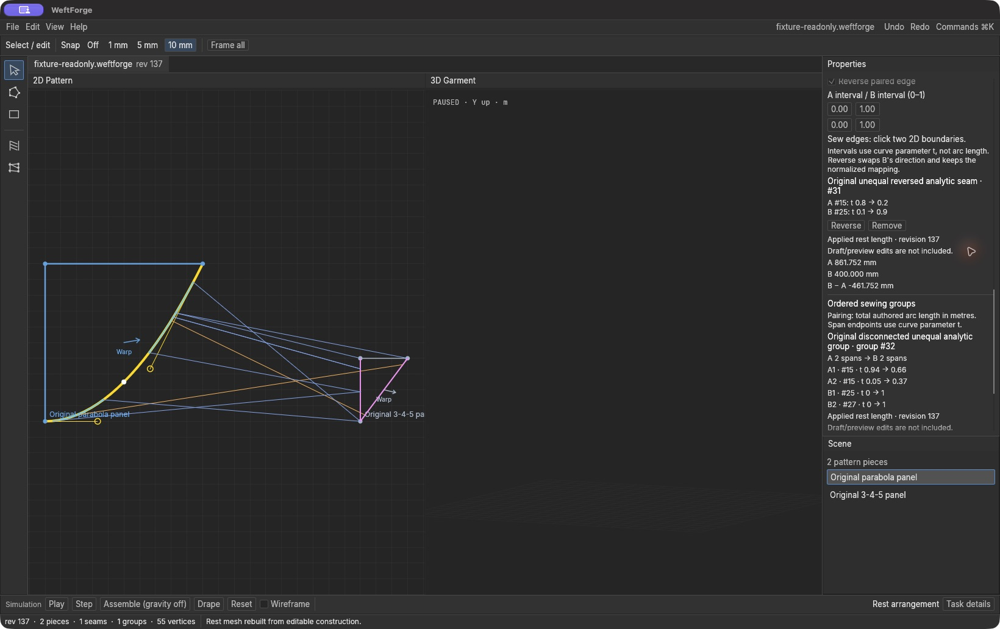

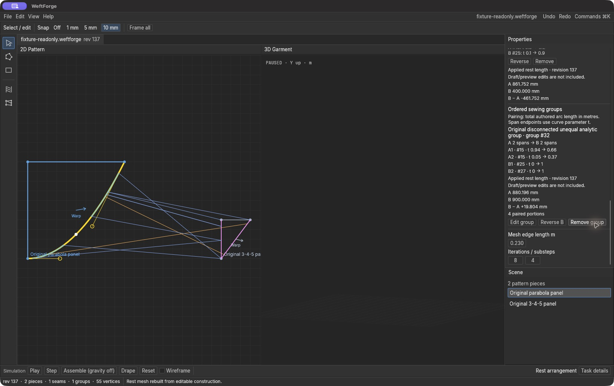

The seam reads 861.752/400.000/−461.752mm; the group reads 880.196/900.000/+19.804mm.
No error threshold is inferred. This read-only case performs no numeric input,
authoring, Save, history, physics or export. See the
[scoped report](../parity/reports/WF-20261115-AUTHORED-LENGTH-001.json).
Native 001 remains stopped on recorder setup; 002 uses the same criteria after the
loader correction. Full source gates pass205 Rust/54 Python checks; the separate
46-process analytic CLI/MCP run preserves files. No complete reference/native
workflow or roadmap acceptance is implied.

## PhotoCraft-inspired shell (7ab)

These are actual native Rust/egui captures. The current images use source
`7ab2107aaa51f2c0fa9c9fd2ada972a08c433882` on macOS arm64 at 1640 × 1032.
[PhotoCraft](https://github.com/storytold/photocraft) informed the compact charcoal
editor structure. WeftForge uses its own garment graphics and working tools.

### Compact workspace at 7ab

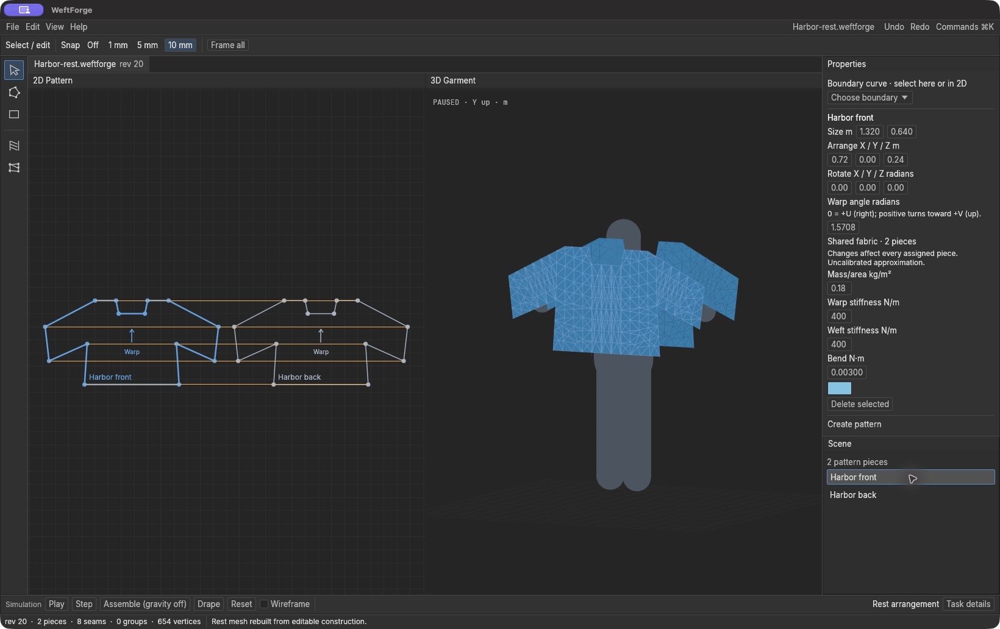

The left tool rail exposes Select/edit, Polygon, Rectangle, Sewing and M:N sewing.
File/Edit/View/Help menus, context controls and a document tab keep the two
canvases prominent. Properties sits above the real Scene list; simulation and
status occupy the bottom rows. Inter and JetBrains Mono are bundled with their
original font licenses.

The existing original Harbor project is paused in Rest at revision 20: two pieces,
eight seams and 654 rest vertices. This read-only preview frames and selects
construction; it performs no numeric authoring, Save, history or simulation.

### Boundary selection at 7ab

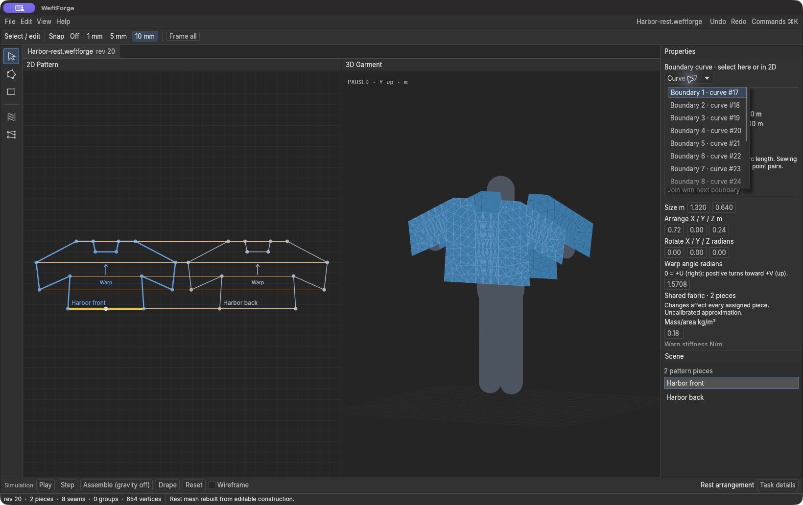

The first boundary is selected with readable light text. Scene rows are left
aligned and selected labels stay light. Global selected text also covers sewing
span choices.

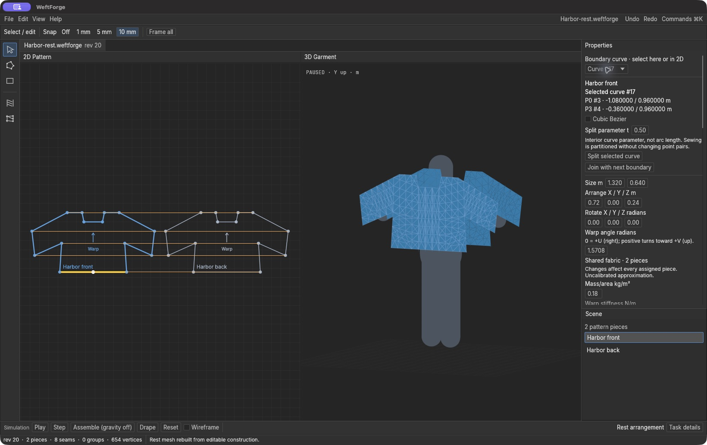

All five local gates passed at this source: 195 Rust tests, 54 Python tests,
formatting, strict Clippy, registry/map verification and unsigned packaging.
The [scoped report](../parity/reports/WF-20261115-PHOTOCRAFT-STUDIO-001.json)
records source/binary identities and limits. Smaller windows, other platforms,
screen-reader use, full native authoring and garment/physics acceptance remain
unverified. Earlier captures below retain their original source and outcomes.

## Historical Snap workspace (21b9)

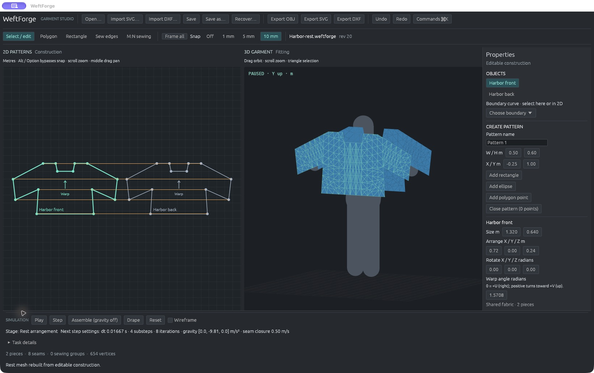

This separate read-only preview loads the existing original Harbor project at
revision 20: two pieces, eight seams and 654 rest vertices. Snap remains 10 mm.
It makes no numeric input, construction edit, Save, history, Snap change or physics
action. It shows the current workspace, not completed garment or snapping quality.
The session-only Off / 1 / 5 / 10 mm preference and Alt/Option bypass are implemented.
The preference applies to pointer positions while numeric edits stay exact.

## Historical task details (21b9)

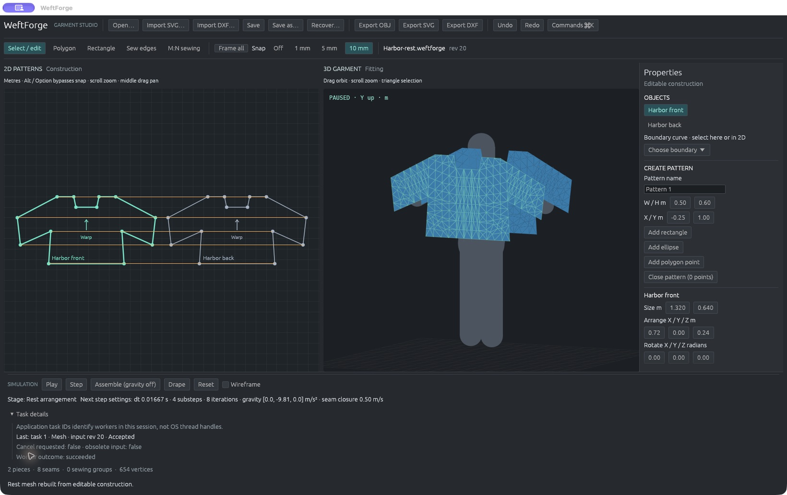

Task details shows Mesh task 1, input revision 20, Accepted, worker outcome
succeeded, cancel=false and obsolete=false. The expanded panel keeps the job
identity and outcome beside the transport while both construction and rest views
remain visible.

Native numeric/snapping and task-lifecycle acceptance remains unverified; see the
[scoped verification report](../parity/reports/WF-20261115-NATIVE-STUDIO-001.json).

## Historical DXF workflow (76be)

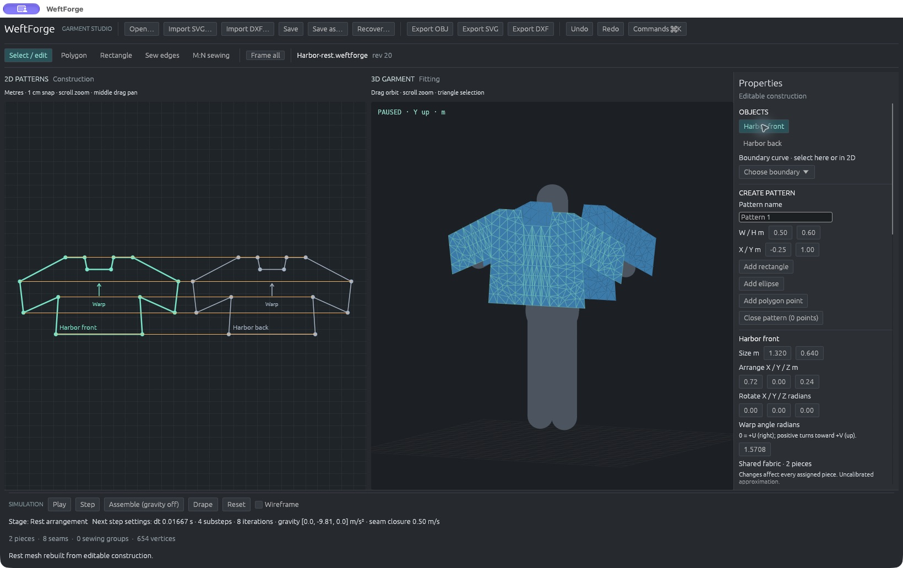

These captures retain their original source 76be results and limits. That report
is stale on the current native source; this publication reruns none of its cases.

The source 76be native workflow adds two original DXF patterns to an existing piece
after review of count, 1 mm per DXF unit, retained origin/layout, layer names and
construction-only scope. The strict R2000 profile accepts ordered closed `LINE`
and clamped cubic `SPLINE` boundaries; it is not general CAD or apparel import.
The [format profile](file-formats.md) lists the accepted structure and omissions.

The observed run retained a pending numeric draft through chooser Cancel,
review Cancel and command-search Escape. One Import combined that draft and
both pieces, followed by two Undo and two Redo actions. An imported cubic stayed
editable: P1 X changed from −0.01 to 0 m, with its other controls retained.
Rejected input left the edited construction intact. Actual quit, fresh Empty
launch, reopen, resave and SVG/DXF exports followed. Independent saved-file and
export grading passed, including exact edited/rejected/reopened native bytes
and an ezdxf 1.4.5 audit with zero errors or fixes. See the
[DXF studio packet](../parity/reports/artifacts/dxf-studio-20261115/README.md)
for the native captures, trace review and separate headless checks.

This supports the bounded observed workflow. The old Redo branch after Cancel
was not invoked before the new import, and the modal did not explicitly name
printing. Background autosaves retained temporary edits even though all original
input primaries remained unchanged. The complete frozen native plan, full
persistence behavior, printing and reference parity remain unestablished.

### DXF review, editing and restoration

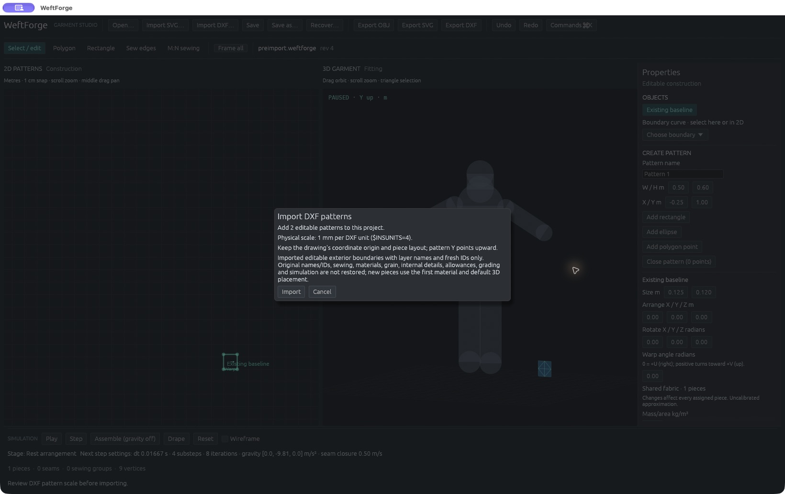

The review shows the bounded construction import. Its text did not explicitly
name printing; the full disclosure criterion remains unestablished.

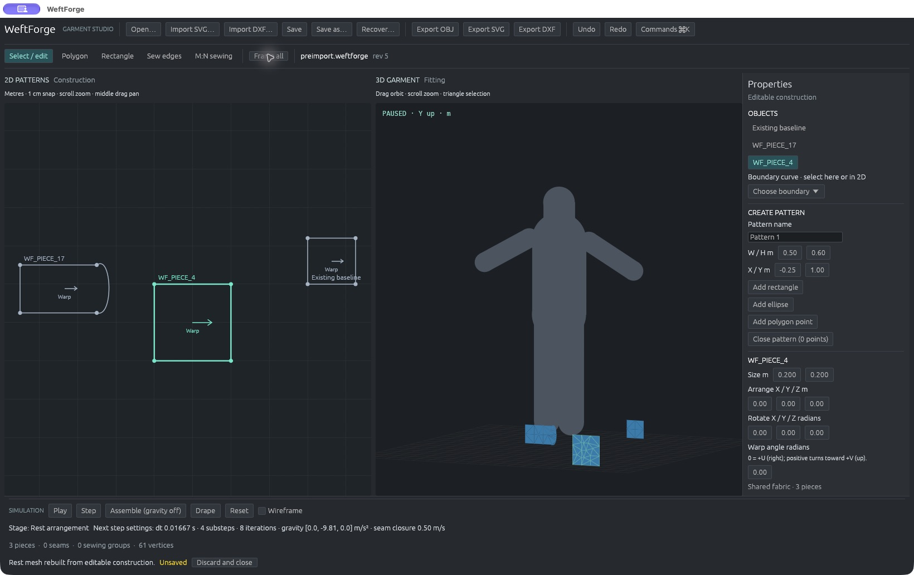

One accepted import produces revision 5 and three editable pieces. The pending
width and both added patterns belong to the same transaction.

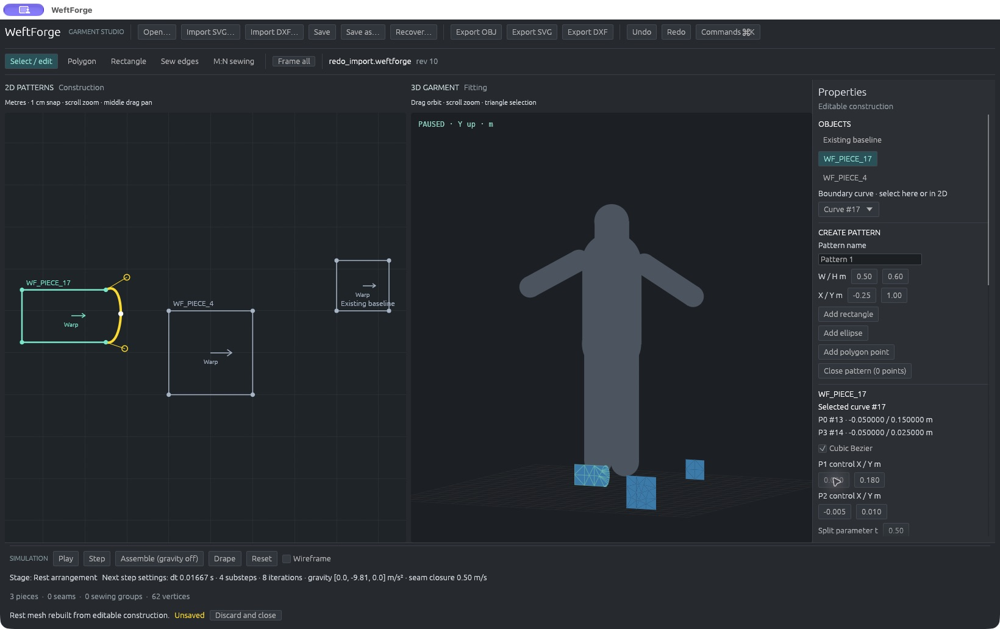

Saved revision 10 changes P1 X from −0.01 to 0 m while retaining the other controls.
This establishes construction editing, not simulated garment quality.

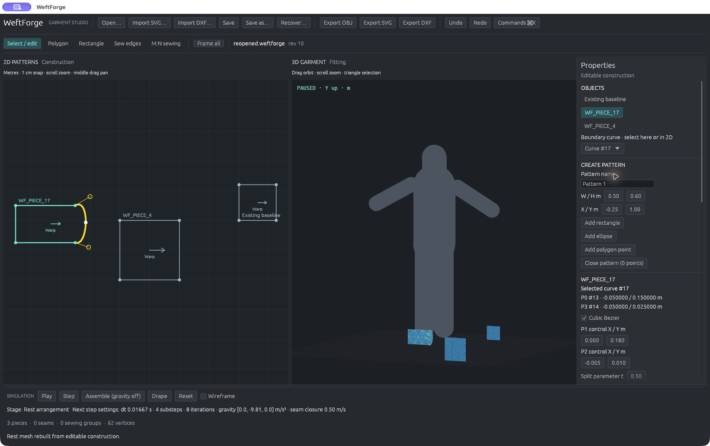

This view follows the third launch used to restore saved revision 10 after the
separate temporary document was explicitly discarded. Phase A quit/fresh-open/
resave is separately recorded; this restoration is not a retry. The source 76be Harbor Rest preview belongs to that earlier checkpoint.

## Historical SVG workflow (32f9)

The following captures belong to source
`32f9b3481c46e28a3b3acc49e6cf3908c7001b28`; they retain that build's results
and limitations.

Import reviews the piece count, physical scale, retained origin and omitted
properties before adding anything. The bounded profile accepts closed absolute
straight/cubic paths with explicit millimetres and uniform viewBox scale. It
imports exterior boundaries and names; the [format profile](file-formats.md)
describes the supported subset.

The selected imported cubic exposes its original control points. This actual
native edit moves its first control X from 0.08 to 0.09 m. **Frame all** keeps the
separated patterns visible using their authored curve bounds.

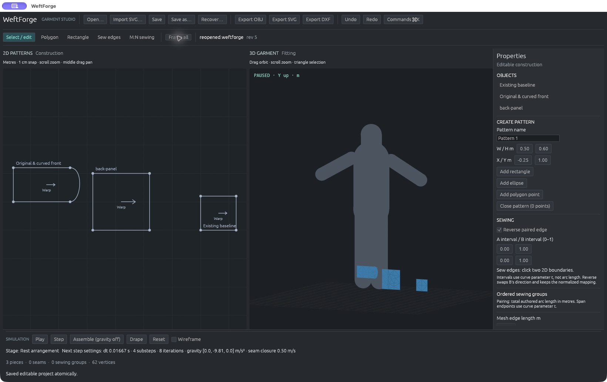

The separate SVG workflow exercised cancellation with a pending numeric edit, atomic
import, one-step Undo/Redo, control editing, invalid-input retention, SVG export
and an actual quit/relaunch/reopen/resave. Independent checks verify geometry,
physical scale, stable IDs and native persistence. The retained earlier v1/v2
strict failures remain separate from the prospectively declared v3 verification;
see the [evidence packet](../parity/reports/artifacts/native-svg-20261115/README.md)
and [current status](../STATUS.md).

## Historical workspace capture (b760)

The following four captures retain their original tested source
`b760b990b142bb46b2481434fead9e7e0178ae0f` and evidence limitations.

The document bar provides open, save, recovery, exports, history and command
search. Pattern tools sit above the two viewports. The inspector exposes
placement, grain, fabric and sewing properties; the transport and diagnostics
stay below the viewports. The pictured Harbor fixture has two editable pieces,
eight seams and 654 simulation vertices after assembly and draping.

## Historical editable ellipses and cubic controls (b760)

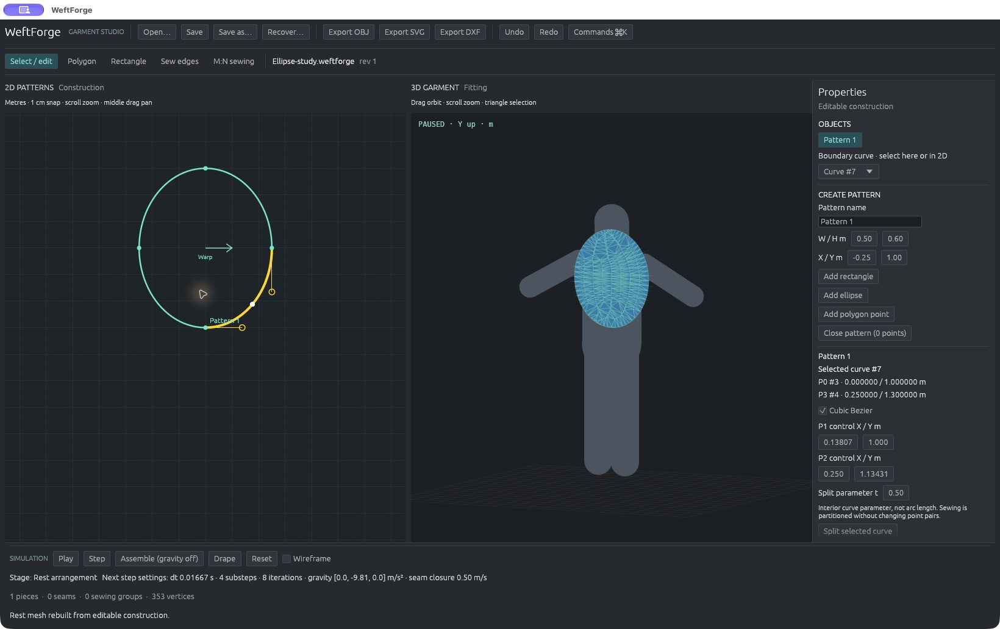

Numeric ellipse creation uses four editable cubic Bézier boundaries. Selected
curves expose their controls and split parameter. The same validated operation
is available through command search, the CLI and the local MCP adapter. This is
a cubic approximation, with no persistent exact-conic constraint after editing.
See the [ellipse contract](../spec/features/PAT-003-original-ellipse-20261114.md).

## Historical ordered sewing and easing (b760)

Ordered M:N groups pair authored boundary spans by cumulative arc length.
The inspector supports partial and reversed spans, ordering and explicit
correspondence instead of pairing mesh vertex indices.

Easing-map knots control correspondence along the two sides. This capture shows
the actual editor dialog on an original five-piece sample, then cancelled
without changing the saved construction.

## Historical preview evidence and remaining work

The earlier gallery establishes the observed b760 layout and displayed authoring
tools at that source. The [retained preview receipt](../parity/reports/artifacts/studio-preview-20261114/PREVIEW-RECEIPT.json)
binds the images to the observed executable and records earlier failed layout
attempts and an undeclared play event. The saved examples are available in the
[document directory](../parity/reports/artifacts/studio-preview-20261114/documents).

The preview loaded existing sample documents. The separate empty-project garment
acceptance remains a different workflow. A zero displayed contact value does
not establish surface clearance: independent checks found triangle/capsule
penetration in the Harbor results. Cloth convergence, full contact coverage,
calibrated fabrics, production rendering, avatar import, animation, advanced
construction and cross-platform launch remain incomplete. See the
[complete roadmap](../ROADMAP.md) and [current status](../STATUS.md).

The original preview checks used shared compiled-cache links. Their raw results
are retained with that qualification. Fresh isolated formatting, workspace tests,
strict Clippy, xtask verification and packaging all passed, reproducing the
observed native executable byte-for-byte. The
[build qualification](../parity/reports/artifacts/studio-preview-20261114/BUILD-ISOLATION-QUALIFICATION.json)
records the finding and correction. GitHub Actions and Pages remain disabled
during development.
