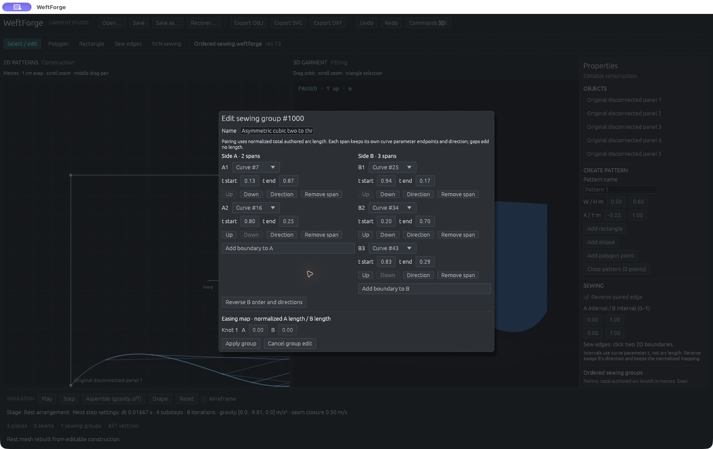

# Native studio preview

These are unedited captures of the running Rust desktop application on macOS,
at 1640 × 1032 pixels. The tested UI source is
`b760b990b142bb46b2481434fead9e7e0178ae0f`. PhotoCraft informed the compact
charcoal workspace and teal accents; the garment documents and application
implementation are original WeftForge work.

## Connected pattern and garment workspace

The document bar provides open, save, recovery, exports, history and command
search. Pattern tools sit above the two viewports. The inspector exposes
placement, grain, fabric and sewing properties; the transport and diagnostics
stay below the viewports. The pictured Harbor fixture has two editable pieces,
eight seams and 654 simulation vertices after assembly and draping.

## Editable ellipses and cubic controls

Numeric ellipse creation uses four editable cubic Bézier boundaries. Selected
curves expose their controls and split parameter. The same validated operation
is available through command search, the CLI and the local MCP adapter. This is
a cubic approximation, with no persistent exact-conic constraint after editing.
See the [ellipse contract](../spec/features/PAT-003-original-ellipse-20261114.md).

## Ordered sewing and easing

Ordered M:N groups pair authored boundary spans by cumulative arc length.
The inspector supports partial and reversed spans, ordering and explicit
correspondence instead of pairing mesh vertex indices.

Easing-map knots control correspondence along the two sides. This capture shows
the actual editor dialog on an original five-piece sample, then cancelled
without changing the saved construction.

## What this preview establishes

The gallery establishes the current native layout and the displayed authoring
tools. The [retained preview receipt](../parity/reports/artifacts/studio-preview-20261114/PREVIEW-RECEIPT.json)
binds the images to the observed executable and records earlier failed layout
attempts and an undeclared play event. The saved examples are available in the
[document directory](../parity/reports/artifacts/studio-preview-20261114/documents).

The preview loaded existing sample documents. The separate empty-project garment
acceptance remains a different workflow. A zero displayed contact value does
not establish surface clearance: independent checks found triangle/capsule
penetration in the Harbor results. Cloth convergence, full contact coverage,
calibrated fabrics, production rendering, avatar import, animation, advanced
construction and cross-platform launch remain incomplete. See the
[complete roadmap](../ROADMAP.md) and [current status](../STATUS.md).

The original preview checks used shared compiled-cache links. Their raw results
are retained with that qualification. Fresh isolated formatting, workspace tests,
strict Clippy, xtask verification and packaging all passed, reproducing the
observed native executable byte-for-byte. The
[build qualification](../parity/reports/artifacts/studio-preview-20261114/BUILD-ISOLATION-QUALIFICATION.json)
records the finding and correction. GitHub Actions and Pages remain disabled
during development.
